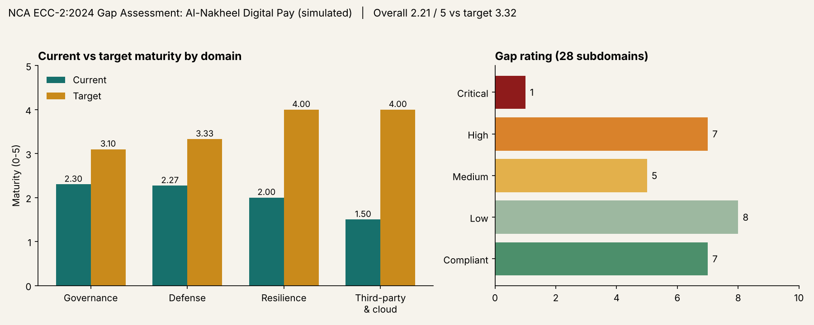

# NCA ECC-2:2024 Gap Assessment & Compliance Roadmap

> **Case-study project.** The organization assessed here, *Al-Nakheel Digital Pay*, is **fictional**. All evidence, findings, and scores are simulated for demonstration. No real client data is used.



## Overview

A control-by-control gap assessment of a fictional Riyadh-based fintech against the **NCA Essential Cybersecurity Controls (ECC-2:2024)** (4 domains, 28 subdomains, 108 main controls), with a crosswalk to **ISO/IEC 27001:2022** and **NIST CSF 2.0**, and a prioritized remediation roadmap. Because SAMA-regulated financial firms follow the **SAMA Cyber Security Framework**, subdomains are also mapped to its four domains as a next step for real-world use.

**Author:** Haneen Al-Mallah | Cybersecurity Engineering, E-JUST

## Scenario

| Item | Value |
|---|---|
| Organization | Al-Nakheel Digital Pay (fictional) |
| Sector | Fintech / digital payments |
| Size | ~350 staff, hybrid cloud (public cloud + one colocation DC) |
| Regulatory drivers | NCA ECC, SAMA Cyber Security Framework, PDPL |
| Assessment type | Documentation review, simulated interviews, sampled technical evidence |

## Results snapshot

| Domain | Subdomains | Avg current | Avg target | Avg gap |
|---|---|---|---|---|
| 1 Governance | 10 | 2.30 | 3.10 | 0.80 |
| 2 Defense | 15 | 2.27 | 3.33 | 1.07 |
| 3 Resilience | 1 | 2.00 | 4.00 | 2.00 |
| 4 Third-Party and Cloud | 2 | 1.50 | 4.00 | 2.50 |

**Overall maturity: 2.21 / 5 against a target of 3.32.** One subdomain is Critical (third-party cybersecurity), 7 are High, 5 Medium, 8 Low and 7 meet target.

**Top priorities:** third-party risk, cloud security, business continuity, incident management, and logging and monitoring.

## Deliverables

| # | Deliverable | Location |
|---|---|---|
| 1 | Scope and methodology | [`docs/01-scope-and-methodology.md`](docs/01-scope-and-methodology.md) |
| 2 | Assessment workbook (scoring, dashboard, 108-control register) | [`workbook/ECC-Gap-Assessment.xlsx`](workbook/ECC-Gap-Assessment.xlsx) |
| 3 | Framework crosswalk (ECC / ISO 27001 / NIST CSF) | workbook sheet `Crosswalk` |
| 4 | Evidence request list | workbook sheet `Evidence Request` |
| 5 | Remediation roadmap (30/90/180/365 days) | workbook sheet `Roadmap` |
| 6 | Executive summary | [`docs/02-executive-summary.md`](docs/02-executive-summary.md) |

## Methodology (summary)

1. **Scope:** define in-scope systems, locations and business processes.
2. **Evidence collection:** request policies, procedures, configurations, logs and records per subdomain.
3. **Assess:** score each subdomain on a 0-5 maturity scale.
4. **Rate gaps:** priority = (target - current) x criticality weight (1-3).
5. **Roadmap:** group remediation into 30/90/180/365-day waves.
6. **Report:** executive summary plus per-subdomain findings.

## Repository structure

```
ecc-gap-assessment/
├── README.md
├── LICENSE
├── docs/
│   ├── 01-scope-and-methodology.md
│   └── 02-executive-summary.md
├── workbook/
│   └── ECC-Gap-Assessment.xlsx
└── images/
    └── dashboard.png
```

## Frameworks referenced

- NCA Essential Cybersecurity Controls (ECC-2:2024)
- ISO/IEC 27001:2022 (Annex A)
- NIST Cybersecurity Framework 2.0
- SAMA Cyber Security Framework (noted for financial-sector context)

> Control numbering follows the official NCA ECC-2:2024 document. Verify wording against the official publication before citing. Crosswalk mappings are indicative, not one-to-one.

## Disclaimer

Educational case study. Not an official NCA assessment and not legal or regulatory advice.
